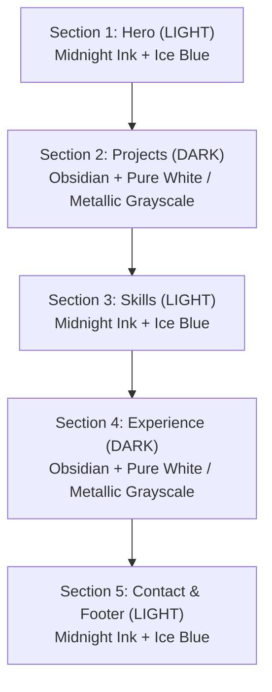

# Design System Master File: Developer Portfolio

> **LOGIC:** Alternating Contrast Rhythm (Chiaroscuro Section Flow).
> Halaman tidak menggunakan toggle Dark/Light button, melainkan mengalirkan ritme pergantian warna antar-bagian secara tegas:
> **Section Terang** (Midnight Ink + Ice Blue) ➔ **Section Gelap** (Obsidian + Pure White / Metallic Grayscale).
>
> ⚠️ **STRICT COLOR RULE:** Tidak boleh ada warna lain selain palet resmi yang ditentukan untuk masing-masing bagian!

---

**Project:** Developer Portfolio  
**Name:** Natanael Sebastian Simanjuntak  
**Role:** Full-Stack & Frontend Developer  
**Architecture:** Alternating Dual-Contrast Sections (Chiaroscuro Section Rhythm)  
**Framework Stack:** Next.js 16 (App Router) + Tailwind CSS v4 + Framer Motion + Lucide Icons  
**Typography:** Geist Sans & Geist Mono  

---

## 1. Strict Color Palettes by Section

### A. Bagian Terang (*Light Sections: Hero, Skills, Contact*)
> **ATURAN MUTLAK:** Hanya menggunakan kombinasi **Midnight Ink** dan variasi **Ice Blue**. Tidak ada warna lain.

| Token / Elemen | Nilai Hex | Peran & Penggunaan |
| :--- | :--- | :--- |
| **Latar Canvas (Base)** | `#E6F3FA` / `#F2F9FD` | Latar sejuk Ice Blue wash yang bersih dan mewah |
| **Surface / Card** | `#FFFFFF` | Permukaan kartu komponen |
| **Teks Utama** | `#090D16` | **Midnight Ink**: Teks judul, display, dan body utama (kontras tinggi) |
| **Teks Sekunder** | `#090D16`/75 (`#334155`) | Subtitle & metadata |
| **Aksen Utama** | `#0284C7` | **Ice Blue Vivid**: Highlight, icon accent, link hover |
| **Aksen Soft / Chip** | `#BAE6FD` / `#E0F2FE` | Background badge, chip, dan border aksen |
| **Tombol CTA Solid** | `#090D16` (teks `#FFFFFF`) | Tombol utama Midnight Ink yang beralih ke `#0284C7` saat hover |

### B. Bagian Gelap (*Dark Sections: Projects, Experience*)
> **ATURAN MUTLAK:** Hanya menggunakan kombinasi **Obsidian** dan **Pure White / Metallic Grayscale**. Tidak ada warna lain.

| Token / Elemen | Nilai Hex | Peran & Penggunaan |
| :--- | :--- | :--- |
| **Latar Canvas (Base)** | `#090A0F` | **Obsidian**: Hitam pekat modern |
| **Surface / Card** | `#11131B` | Permukaan kartu elevated bernuansa metallic slate |
| **Teks Judul / Display** | `#FFFFFF` / `#F8FAFC` | **Pure Metallic White**: Legibilitas maksimal |
| **Teks Deskripsi** | `#94A3B8` | **Metallic Slate**: Deskripsi dan metadata |
| **List Highlights** | `#E2E8F0` | Teks poin pencapaian |
| **Border & Divider** | `#1E2333` / `#2A324B` | Garis batas tipis bernuansa metallic |
| **Tech Stack Chips** | `#181B26` (teks `#E2E8F0`) | Badge teknologi monochrome |

---

## 2. Page Flow & Section Sequencing

1. **Section 1: Hero (TERANG - Borderless Edge-to-Edge)**:
   - Layout kanvas majalah editorial penuh tanpa batas tepi (*full-bleed edge-to-edge*).
   - Teks display raksasa: **NATANAEL SEBASTIAN SIMANJUNTAK** dalam 3 susunan baris berbobot tinggi.
   - Rel sosial kiri bersih (`GH`, `IN`, `X`, `CV`) merapat ke sisi kiri tanpa elemen berputar.
   - Foto portrait menyatu langsung ke dasar lantai hero.
   - Komponen merapat ke ujung layar tanpa margin/gap berlebihan.
2. **Section 2: Projects / Work (GELAP)**:
   - Warna: Obsidian pekat (`#090A0F`) dengan kartu Bento `#11131B`, border `#1E2333`, teks `#FFFFFF` dan `#94A3B8`.
3. **Section 3: Skills / Matrix (TERANG)**:
   - Warna: Kanvas Ice Blue (`#E6F3FA`), kartu `#FFFFFF`, border `#BAE6FD`, teks Midnight Ink (`#090D16`), chip level `#0284C7`.
4. **Section 4: Experience / Track Record (GELAP)**:
   - Warna: Obsidian pekat (`#090A0F`), garis timeline `#1E2333`, titik putih `#FFFFFF`, teks `#FFFFFF` & `#94A3B8`.
5. **Section 5: Contact & Footer (TERANG)**:
   - Warna: Kanvas Ice Blue (`#E6F3FA`), kartu besar `#FFFFFF` dengan border `#BAE6FD`, tombol copy email, teks Midnight Ink (`#090D16`).

---

## 3. Pre-Delivery & Quality Assurance

- [x] **No Theme Toggle Button:** Tidak ada tombol pengalih tema global; ritme warna dinikmati secara natural melalui alur scroll.
- [x] **Color Isolation:** Bagian terang 100% bebas dari warna non-Midnight/Ice Blue; bagian gelap 100% bebas dari warna non-Obsidian/Grayscale.
- [x] **Universal Floating Nav:** Dock navigasi muncul halus saat scroll dengan kontras tinggi melintasi area terang maupun gelap.
- [x] **Zero Build Errors:** Terverifikasi lulus `npm run lint` dan `npm run build` Turbopack.
